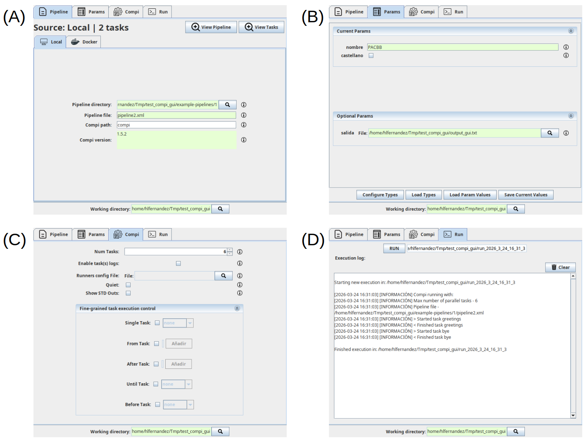

.. _gui:

Compi GUI
*********

The Compi GUI is a standalone desktop application that serves as a universal graphical interface for Compi pipelines. It provides four tabs that guide the user through the full cycle of configuring and executing a pipeline: Pipeline, Params, Compi, and Run.

   Screenshots of the main Compi GUI panels. (A) Pipeline tab, where the user provides the Compi pipeline information either from a local file or from a Dockerized Compi pipeline. (B) Params tab, where users can give values to the pipeline parameters and set their types to have proper input components. (C) Compi tab, where users can set the values of the ``compi run`` command options. (D) Run tab, where users can run the pipeline and see the execution logs.

Pipeline tab
============

When the application is started, the first tab — Pipeline — requires the user to select a working directory and then a pipeline file or a Docker image containing a pipeline. This tab also allows the user to view the pipeline contents or a table listing the tasks and their descriptions.

Selecting the working directory and the pipeline file has two effects. First, the application creates a ``compi-gui.json`` file in the working directory storing the pipeline file (or Docker image) along with the Compi executable path, allowing users to resume their work in future sessions. Second, it enables the remaining application tabs: Params, Compi, and Run. When a working directory is selected, the application will automatically look for an existing ``compi-gui.json`` file in order to load the associated pipeline and the last parameter types configuration.

Params tab
==========

The Params tab is created dynamically after pipeline selection. It provides a convenient interface for setting pipeline parameter values, organised into two separate sections: one for mandatory parameters and another for optional ones (i.e. those that have a default value declared in the pipeline file).

By default, the input component for each parameter is a textbox, except for flags, for which a checkbox is used. The ``Configure Types`` button allows users to assign more specific types to parameters — ``file``, ``directory``, ``number``, or ``decimal`` — so that a more appropriate input component is presented. These type assignments are automatically saved in the ``compi-gui.json`` file and restored in subsequent sessions within the same working directory.

Compi tab
=========

The Compi tab allows users to configure general options of the ``compi run`` command. These include the number of parallel tasks, log management, and fine-grained task execution control. The input dialogs for log management and task execution control are generated dynamically based on the tasks present in the current pipeline, allowing users to select or deselect individual tasks by their identifiers.

Run tab
=======

The Run tab allows users to execute the selected Compi pipeline using the current parameter values and Compi options. Each run generates a ``run.sh`` script and a ``compi.params`` file in a new subdirectory named ``runs/run_<timestamp>`` inside the working directory, where the run logs are also stored.
